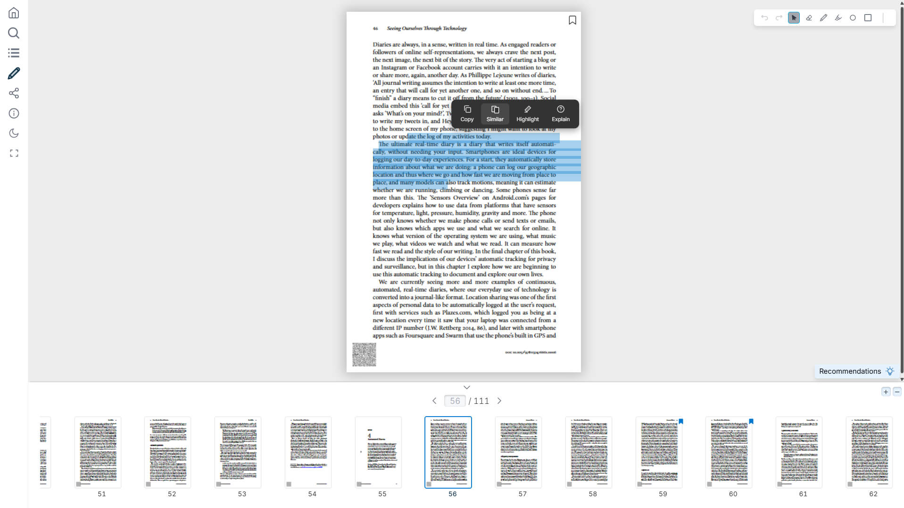

<div align="center">
  <h1>EvilFlowersViewer</h1>
  <p><strong>A focused, extensible PDF workspace for the browser</strong></p>
  <p>
    Read, search, annotate, cite and share documents without leaving the page.
  </p>
  <p>
    <a href="https://github.com/EvilFlowersCatalog/EvilFlowersViewer/releases">
      
    </a>
    <a href="https://www.npmjs.com/package/@evilflowers/evilflowersviewer">
      
    </a>
    <a href="https://github.com/EvilFlowersCatalog/EvilFlowersViewer/blob/main/LICENSE">
      
    </a>
  </p>
  <a href=".github/assets/viewer-preview.jpg">
    
  </a>
</div>

EvilFlowersViewer is a PDF viewer based on the pdf.js library that lets users view and interact with PDF documents
directly in the browser. Developed by a university team, it is reliable, efficient and easy to customize.

## Features

- PDF document rendering directly in the browser
- Zoom in and out of documents
- Page navigation through a page thumbnail view
- Text search within documents
- Optional semantic / AI search shown alongside keyword results
- Share the entire document or with selected pages
- Citation export in BibTeX, BibLaTeX, RIS and bibliography
- Print the entire document or with selected pages
- Download document
- Light / dark themes (honours the host-provided theme, else the reader's saved choice, else the system preference)
- Fullscreen mode
- Editing document (freehand, shapes, highlighter, eraser, undo/redo) from a drawing rail docked
  beside the page, so it never covers the document
- Page bookmarks, shown on the page corner and on the thumbnails
- Keyboard-friendly and screen-reader accessible (see [Accessibility](#accessibility))

### Intelligent viewer

Each of these appears only when the host passes the callback it needs (see
[Intelligent viewer](#intelligent-viewer)):

- **Explain** a selected passage, a figure, a table or an equation in a draggable popup, and hand
  the explanation over to the chat
- **Reading chat** about the open publication, docked beside the page: streamed answers with
  links back into the book, recommended publications as cards, and attachments (selected
  text, explanations, figures, highlights) as removable chips
- **Chat history**: reopen earlier conversations; chats about other publications are read-only
- **Figure, table and equation hover**: outlines what the catalog extracted from the page,
  with a card showing the crop, caption, table or LaTeX and actions for the chat and explain
- **AI highlights**: sentences the assistant marked for a prompt, drawn over the text, with a
  comment badge per highlight, a sidebar list to step through them, and show/hide per
  annotation
- **Recommendations**: similar, prerequisite and advanced publications for the open page or a
  selection

## Styling & isolation

All viewer styles are scoped under a single `.efv-viewer` root class and Tailwind's
global preflight is disabled, so **importing this library never restyles the host
application** (`*`, `body`, buttons, inputs and scrollbars are left untouched). It works the
other way too: every utility is emitted as `.efv-viewer .x` (Tailwind `important:
'.efv-viewer'`), so a host that ships its own `.text-primary` or `.bg-secondary` cannot
recolour the viewer. The Inter font is self-hosted (no external Google Fonts request).
Consumers just import the stylesheet — no manual scoping/wrapping required:

```ts
import '@evilflowers/evilflowersviewer/dist/style.css';
```

## Accessibility

The viewer is built to be usable with a keyboard and assistive technologies:

- **Keyboard**: all controls are reachable via <kbd>Tab</kbd>; page thumbnails, tools
  and color swatches respond to <kbd>Enter</kbd>/<kbd>Space</kbd>. Shortcuts:
  <kbd>←</kbd>/<kbd>→</kbd> page, <kbd>+</kbd>/<kbd>-</kbd> zoom, <kbd>F</kbd> search,
  <kbd>T</kbd> table of contents, <kbd>I</kbd> info, <kbd>S</kbd> share, <kbd>C</kbd>
  citation, <kbd>Esc</kbd> steps back out (explain popup → modal → panel → tool → zoom → page →
  close). Typing in any text field, the host's included, never triggers these shortcuts.
- **Screen readers**: every icon-only button has an accessible name (localized), toggles
  expose `aria-pressed`/`aria-expanded`, the left rail is a `role="toolbar"`, dialogs are
  `role="dialog"` + `aria-modal` with focus trapping, and loaders announce via
  `role="status"`. The rasterized page canvas is `aria-hidden`; the selectable pdf.js text
  layer carries the readable content, and the current search match is marked on it
  (`role="mark"`, `aria-current="true"`).
- **Focus & motion**: a visible `:focus-visible` ring is shown for keyboard users, and all
  animations respect `prefers-reduced-motion`.
- The viewer root carries a `lang` attribute matching `options.lang` so pronunciation is
  correct. All a11y CSS is scoped under `.efv-viewer` and never touches the host page.

## Getting started

**Requirements:** Node **≥ 22.13** (required by pdfjs-dist 6).

To get started with EvilFlowersViewer, follow these steps:

1. Install EvilFLowersViewerPackage:

```bash
# a release tag
npm install "github:EvilFlowersCatalog/EvilFlowersViewer#v0.8.0"   # or #semver:^0.8.0
# the latest of a branch (develop = dev, main = prod)
npm install "github:EvilFlowersCatalog/EvilFlowersViewer#develop"
# or from npm (tagged versions only)
npm install @evilflowers/evilflowersviewer
```

Installed from git, the package builds its own `dist/` (the `prepare` script). Only tags
after `v0.7.9` can be installed this way.

**Releasing:** bump `version` in `package.json`, then push a matching tag
(`git tag v0.8.0 && git push origin v0.8.0`). The Publish workflow checks the tag matches
`package.json`, type-checks, and publishes the version to npm. No GitHub Release is needed.

2. Import the default `renderPDFViewer` function and the stylesheet:

```ts
import renderPDFViewer from '@evilflowers/evilflowersviewer';
import '@evilflowers/evilflowersviewer/dist/style.css';
```

3. Call it with a single options object. It returns the Vue `App` instance so you
   can unmount it on teardown, with `app.viewer` to drive it afterwards:

```ts
const app = renderPDFViewer({
  rootId: '#my-viewer',      // CSS selector of the mount element
  data: uint8ArrayOfPdf,      // TypedArray of the PDF bytes (or `url`, below)
  options: { theme: 'light', lang: 'en' /* … */ },
  config: { download: true, share: true, print: true, edit: false },
});

app.viewer.goToPage(12);      // see "Controlling the viewer"

// later, e.g. on route change:
app.unmount();
```

## Streaming a PDF by URL

Pass `url` instead of `data` and the first page paints before the file has arrived
(the server must answer HTTP Range: `Accept-Ranges: bytes`, `206`, and, cross-origin,
expose `Accept-Ranges, Content-Range, Content-Length` via CORS).

```ts
renderPDFViewer({
  rootId: '#viewer',
  url: 'https://catalog.example/api/v1/acquisitions/42/content',
  // A function, not an object: called before every request, so an expired token
  // is refreshed mid-read. On a 401/403 it is called once more with
  // { retry: true } and that request is retried; concurrent failures share it.
  httpHeaders: ({ retry }) => auth.headers({ forceRefresh: retry }),
  streaming: false,            // true: fetch only what the open page needs
  options: {
    pdfAssetsUrl: '/pdfjs/',   // serve pdfjs-dist/{wasm,cmaps,standard_fonts,iccs}/ here
    onFirstPageRendered: (i) => faro.pushMeasurement({ type: 'viewer', values: { first_page_ms: i.durationMs } }, { context: { source: i.source, streaming: String(i.streaming) } }),
    onStreamError: ({ status }) => status === 401 && auth.refresh(),
  },
});
```

- **Without `streaming`** (default) pdf.js keeps fetching the rest in the background
  after page 1 (a thin bar on top of the page shows it), so search, print and download
  behave as with `data`.
- **With `streaming: true`** it fetches only the ranges the open page needs. Best for
  very large scans; full-text search, print and download then cause many requests, and
  the table of contents is read when the reader first opens it. How much page 1 needs
  depends on the file and has to be measured on the real files: in local tests pdf.js
  (6.1 and 6.5 alike) read nearly every sample file whole before opening it.
- `rangeChunkSize` defaults to 512 KiB (pdf.js: 64 KiB, i.e. ~100 requests for a 6.7 MB
  book, each through the host's authorisation).
- With an **object** `httpHeaders` pdf.js loads the file itself: one GET it aborts after
  the headers, then Range requests to the same URL. **Never pass a single-use URL.** The
  headers are fixed for the whole document; if the token can expire while a book is
  open, pass a function instead.
- A failed range after the document opened shows a "Reconnect" notice and calls
  `onStreamError`. `app.viewer.retry()` (or the button) re-requests the missing ranges
  with a function `httpHeaders`; with pdf.js' own loader (object headers, signed URL) it
  reopens the document at the current page.

**Security / CSP.** The viewer renders no PDF forms or AnnotationLayer and keeps XFA off,
so PDF JavaScript never runs (CVE-2026-16633 needs pdf.js' scripting). Hosts should still
send a `Content-Security-Policy` with a `script-src` that excludes `'unsafe-eval'`
(pdf.js 6 needs no eval), allow `worker-src 'self' data: blob:` (the bundled pdf.js
workers are `data:` URLs) and the PDF origin (and `pdfAssetsUrl`) in `connect-src`.

## Controlling the viewer

`app.viewer` (`IViewerController`) works at any time; before the document has loaded,
`goToPage` and `focus` set where it opens.

| Method | |
| --- | --- |
| `open(source, { initialPage?, initialFocus? }?)` | Swap the document (`data` or `url` + options) without remounting. |
| `retry()` | Reload after a failure, or re-request ranges after a stream error. |
| `goToPage(n)` / `nextPage()` / `previousPage()` | Navigate. `goToPage` is recorded in the back/forward history. |
| `goToLabel('iv')` | Go to the page the PDF *labels* `iv` (printed page numbers). Resolves to the physical page or `null`. |
| `goToDestination('chapter-3')` | Go to a named destination (`#nameddest=`). Resolves like `goToLabel`. |
| `back()` / `forward()` | Walk the jump history (links, contents, search, citations, host jumps; not page turns). |
| `focus(IViewerFocus)` | Scroll to, outline and flash a cited paragraph or figure. |
| `getOutline()` | The table of contents as `IOutlineEntry[]` (`{ title, page, level, children }`) for the host's own UI. |
| `openPanel('toc' \| 'pages' \| 'search' \| 'highlights' \| 'share' \| 'info' \| 'print' \| null)` | Open a Navigator section, or the Share/Info/Print card. |
| `search(query, { caseSensitive?, wholeWord?, ignoreDiacritics?, openPanel? })` | Search the text, highlight every match, go to the first one after the current page. Resolves `{ total, pages, truncated }`. |
| `searchNext()` / `searchPrevious()` / `clearSearch()` | Step through or clear the results. |
| `showResults(passages, { label?, select?, openPanel? })` | Show the host's own passages (`{ page, text, rects?, title?, reason?, id? }`, e.g. the sources of a chat answer) as a labelled section: highlighted on their pages (by `rects`, else by finding `text` on the page) and stepped with ‹ ›. |
| `setTheme('dark' \| 'light' \| null)` / `setLang('sk' \| 'en')` / `setScale(1.5)` | Live changes. |
| `getState()` | `{ page, totalPages, pageLabel, canGoBack, canGoForward, scale, theme, lang, status, progress }`. |

**Events** (all optional, all on `options`, none carries document content):
`onDocumentLoaded({ totalPages, source, streaming, totalBytes })`,
`onFirstPageRendered({ page, durationMs, source, streaming, bytesLoaded, totalBytes })`,
`onLoadProgress({ loaded, total })` (one per frame at most),
`onPageChange({ page, totalPages, pageLabel, previousPage, cause, canGoBack, canGoForward })`,
`onDocumentError({ stage, reason, status, source })`, `onStreamError({ status })`,
`onSearch({ query, source, total, pages, truncated })`,
`onSearchResultSelect({ source, index, page, id })`.

`semanticSearchFunction(query, { page })` results show as **Related passages** above the
text matches (one list, no mode). Give them `rects` (page fractions) for exact marks;
without, the viewer finds `text` on `page` and marks it.

`onPageChange.cause` says why the page changed: `initial`, `step`, `input`, `thumbnail`,
`link`, `outline`, `search`, `citation`, `history` or `host`. A host can keep the page in
its own URL (`?page=`) on every change, push browser history only for jumps, and offer
its own back button from `canGoBack`.

**Reading:** all pages scroll continuously; ↑/↓, PageUp/PageDown and the trackpad scroll,
←/→ jump a page, Home/End go to the first/last page, Alt+←/Alt+→ walk the jump history,
and after a jump a **Back to p. N** chip returns to where the reader was (stepping through
search hits counts as one jump). Pinch (trackpad or touch) or Ctrl/Cmd + `+` `-` `0`
zoom the document. When the PDF defines page labels, the page box shows and accepts
them ("iv", "12") with the physical number beside.

**Shortcuts** (single keys, ignored while typing): `F` / Ctrl/Cmd+F find, `T` Navigator,
`C` cite, `S` share, `P` print, `D` download, `I` info, `R` recommendations, `E` draw,
`A` ask, `Esc` closes the top-most card or panel.

**Layout:** one top bar; the **Navigator** on the left (Contents · Pages · Search · Notes)
for finding your way; actions open as cards under their own button (Cite, Share, Print,
Info). `openPanel('share' | 'info' | 'print')` opens those cards; the other panel names
open the Navigator section. Drawing is a mode (`E`) with its own tool rail.

# Viewer Options and Properties Documentation

| Input                         | Description                                                                         |
| -------------------------     | ----------------------------------------------------------------------------------- |
| rootId                        | ID of your component where you use the `renderViewer` function.                     |
| data                          | TypedArray (e.g. `Uint8Array`) with the PDF bytes. Pass either `data` or `url`.     |
| url                           | URL of the PDF. pdf.js fetches it itself and shows a progress bar; when the server answers HTTP Range requests (`Accept-Ranges: bytes`, `206`), page 1 renders before the whole file has downloaded. Without Range support the file is streamed whole. |
| httpHeaders                   | Optional `Record<string, string>` sent with every `url` request, e.g. `Authorization`, or a function `({ retry }) => headers` called before every request (see [Streaming](#streaming-a-pdf-by-url)). |
| withCredentials               | Optional boolean. Send cookies with cross-origin `url` requests.                    |
| rangeChunkSize                | Optional number. Bytes per Range request (default 524288).                          |
| streaming                     | Optional boolean. Range-only loading for `url`: no background prefetch.             |
| length                        | Optional number. File size, used with a function `httpHeaders` when the server's 206 has no total. |
| options                       | Optional object consisting of theme, language, citationBib, homeFunction, etc.      |
| options.theme                 | 'dark' or 'light'. Forces the viewer's theme. Without it the viewer uses the reader's last choice of the sun/moon toggle (saved in `localStorage` as `efv-theme`), else the system preference, which it follows live. |
| options.lang                  | 'sk' or 'en'. Specifies the language of the viewer.                                 |
| options.citationBib           | String or null. Contains the citation of the document (e.g., `@article{name, ...}`). |
| options.homeFunction          | Function (type: `() => void`) or null. Redirects to the home view.                  |
| options.closeFunction         | Function (type: `() => void`) or null. Closes the viewer.                           |
| options.shareFunction         | Function (type: `(pages: string | null, expaireDate: string) => Promise<string>`) or null. Generates a shareable link for the document. |
| shareFunction.pages           | String with selected pages (e.g., '1,3-6,10') or null (indicating no pages).        |
| shareFunction.expaireDate     | ISO string specifying the lifespan of the shared document.                          |
| shareFunction => return       | Returns a string containing the link to the shared document.                        |
| options.printFunction         | Function (type: `(pages: string | null) => Promise<string>`) or null. Generates a printable version of the selected pages. |
| options.semanticSearchFunction | Function (type: `(query: string, context?: { page }) => Promise<ISemanticSearchResult[]>`) or null. Optional semantic/AI search. Its results (`{ page, text, score?, id?, title?, reason?, rects? }`) appear as "Related passages" above the text matches; when omitted search is text-only. |
| options.editPackage           | Optional object for managing edit features, containing the following functions:     |
| editPackage.saveGroupFunc     | Function (type: `(name: string) => Promise<{ response: { id: string } }>`). Saves a new group and returns its ID. |
| editPackage.getGroupsFunc     | Function (type: `() => Promise<{ id: string; name: string }[]>`). Retrieves all available groups. |
| editPackage.saveLayerFunc     | Function (type: `(svg: string, groupId: string, page: number) => Promise<ILayer | null>`). Saves a new layer to a group on a specific page. |
| editPackage.updateLayerFunc | Function (type: `(id: string, svg: string, groupId: string, page: number) => Promise<void>`). Updates an existing layer in a group on a specific page. |
| editPackage.getLayerFunc  | Function (type: `(page: number, groupId: string) => Promise<ILayer | null> | null`). Retrieves a layer from a group on a specific page. |
| editPackage.getLayersFunc | Optional function (type: `(groupId: string) => Promise<IPageLayer[]>`, `IPageLayer` = `{ id, svg, page }`). Returns every layer of the group in one request; the viewer loads them once on entering edit mode, pages missing from the result have no layer, and page flips no longer fetch. On failure the viewer falls back to `getLayerFunc`. With the catalog: `GET /api/v1/annotation-items?annotation_id=<groupId>&paginate=false`. |
| options.pageBookmarkPackage | Optional `{ getBookmarksFunc, addBookmarkFunc, removeBookmarkFunc }` persisting page bookmarks. Without it bookmarks still work but last only as long as the viewer. |
| options.openEntryDetailFunction | Function (type: `(entry: ISuggestedEntry) => void`). Opens the host's detail view for a clicked publication card (recommendations, chat). |
| options.bookmarkToggleFunction | Function (type: `(entry: ISuggestedEntry) => Promise<{ isOnShelf, shelfRecordId? }>`). Adds or removes a card's publication from the reader's shelf. |
| options.suggestionsFunction | Function (type: `(kind: SUGGESTION_KIND, context?: { selectedText?, page? }) => Promise<ISuggestedEntry[]>`). Enables recommendations and the selection menu's "Similar". |
| options.explainFunction   | Function (type: `(text: string, context?: IExplainContext) => Promise<IExplainResult>`). Enables "Explain"; `context` carries `page` and, for a figure/table/equation, `regionId`. |
| options.initialFocus      | Optional `IViewerFocus` `{ page?, paragraphId?, regionId?, bbox?, quads?, quadsPage? }` (page fractions, top-left origin). Opens at `page` (wins over `initialPage`), scrolls `bbox` into view, outlines it and flashes the sentence `quads` on `quadsPage ?? page`, then fades after a few seconds. Nothing is added to the highlight layers. A `regionId` without a box flashes that region of `regionPackage`; a `paragraphId` alone only opens the page. |
| options.chatPackage       | Optional `IChatPackage`. Enables the reading chat — see [Intelligent viewer](#intelligent-viewer). |
| options.regionPackage     | Optional `IRegionPackage`. Enables figure/table/equation hover.                      |
| options.agentAnnotationPackage | Optional `IAgentAnnotationPackage`. Enables the AI highlight layer and its sidebar. |
| options.onFirstPageRendered | Optional `(info: IFirstPageRenderedInfo) => void`, `{ page, durationMs, source, streaming, bytesLoaded, totalBytes }`. Called once per opened document when its first page is painted; `durationMs` runs from the start of the load inside the viewer (with `data` it excludes the host's own download). No document content, so it can go to telemetry. A swapped document reports again. |
| options.onDocumentError   | Optional `(info: { stage, reason, status, source }) => void`. `stage` is `download`, `parse` or `render`; `reason` one of `load-error-auth`, `-not-found`, `-network`, `-invalid`, `-password`, `-unknown`; `status` the HTTP status when there was one. Called at most once per opened document when it fails before its first page is painted. |
| options.onDocumentLoaded / onLoadProgress / onPageChange / onStreamError | Optional. See [Controlling the viewer](#controlling-the-viewer). |
| options.pdfAssetsUrl      | Optional string. Where the host serves `pdfjs-dist`'s `wasm/`, `cmaps/`, `standard_fonts/` and `iccs/` (same version as the viewer's). Enables the Wasm JPX/JBIG2 decoders for scans and correct glyphs for CJK and non-embedded fonts. |
| options.workerRendering   | Optional boolean. Draw pages in pdf.js' renderer worker, keeping the main thread free. The worker script is loaded only when this is on. |
| config                    | Optional configuration object controlling viewer features.                          |
| config.download           | Boolean. Enables or disables the download feature.                                  |
| config.share              | Boolean. Enables or disables the share feature.                                     |
| config.print              | Boolean. Enables or disables the print feature.                                     |
| config.edit               | Boolean. Enables or disables the edit feature.                                      |

## Intelligent viewer

The viewer never talks to a backend itself. Every intelligent feature is a host callback, and
**a feature is hidden entirely when its callback is not passed** — no button, no menu entry, no
layer. All types are exported from the package.

### Coordinates and pages

- Page numbers are always the **reader's** page numbers (1-based, as shown in the viewer). A
  host serving a cut or re-ordered copy converts them before answering.
- Positions (`IPageBox`) are fractions `0..1` of the page width and height with a **top-left
  origin**: `{ x0, y0, x1, y1 }`. They stay correct at any zoom.

### Chat — `options.chatPackage`

```ts
chatPackage: {
  // Required. Stream the answer through the handlers; resolve when done.
  // chatId is the conversation to continue, or null to start one — return the id used.
  sendMessageFunc: async (message, contexts, { onChunk, onMessage, onEntries, onError }, { page, chatId }) => {
    // ...
    return { chatId };
  },
  resetFunc: () => {},                 // optional: forget the current conversation
  suggestions: ['Summarize this chapter'], // optional: prompt shortcuts in an empty chat
  getChatsFunc: async () => [...],     // optional, with getChatFunc: enables chat history
  getChatFunc: async (chatId) => [...],
  deleteChatFunc: async (chatId) => {}, // optional: delete buttons in history
  entryId: 'abc',                       // optional: id of the open publication
  openCitationFunc: (citation) => {},   // optional: opens a citation of another publication
}
```

- The open publication is always the chat's subject and is not sent as a context. `contexts`
  carries what the reader attached: `selection`, `explain`, `region` or `highlight`
  (`IChatContext`).
- Answer text is markdown. `[[page:12]]` and `[[region:<id>]]` render as links that jump into the
  book. `onEntries` shows publications as cards (the assistant's recommendation tool).
- Evidence labels `[E3]` (a passage) and `[F2]` (a figure, table or equation), also grouped as
  `[E3, F2]` or `[E3; E5]`, become chips once `onCitations` (or `IChatMessage.citations` from
  history) resolves them (`IChatCitation`). Hovering a chip shows its title, page, section and
  `quote`, or a figure's `imageUrl` and `caption`. Clicking a chip of the open publication
  (`entryId` matches the package's `entryId`, or the package has no `entryId`) jumps to it like
  `initialFocus`. Clicking a chip of any other publication calls `openCitationFunc`; without that
  function such chips are inert.
- History lists `IChatSummary` items; `aboutThisBook: false` chats open read-only.

### Regions — `options.regionPackage`

```ts
regionPackage: {
  // Called once per page and cached.
  getRegionsFunc: async (page) => [
    { id, kind: 'figure' | 'table' | 'equation', page, bbox, caption, category, markdown, latex, imageUrl },
  ],
}
```

Without `imageUrl` the card crops the region from the rendered page.

### AI highlights — `options.agentAnnotationPackage`

```ts
agentAnnotationPackage: {
  getAnnotationsFunc: async () => [
    { id, title, prompt, summary, status: 'pending' | 'done' | 'failed', unresolvedCount,
      highlights: [{ id, seq, page, quads: [IPageBox, ...], text, note }] },
  ],
  requestAnnotationFunc: async (prompt) => annotation, // optional: "ask to highlight" box
  deleteHighlightFunc: async (annotationId, highlightId) => {}, // optional
  deleteAnnotationFunc: async (annotationId) => {},             // optional
}
```

Each highlight is one sentence in reading order (`seq`), with one quad per text line.

### Trying it locally

`npm run dev` mounts the sample app (`src/App.vue`) with every feature wired to mocks in
`src/assets/examples/params/examples.ts`. The AI highlight mock reads the sample PDF's real text
lines, so highlights land on actual text; region boxes are fixed per page.


## Contributing

We welcome contributions from the community to help make EvilFlowersViewer even better. To contribute, please follow
these steps:

1. Fork the EvilFlowersViewer repository
2. Create a new branch for your changes
3. Make your changes and commit them with a clear commit message
4. Push your changes to your forked repository
5. Create a pull request to merge your changes into the main EvilFlowersViewer repository

## Acknowledgment

This open-source project is maintained by students and PhD candidates of the
[Faculty of Informatics and Information Technologies](https://www.fiit.stuba.sk/) at the Slovak University of
Technology. The software is utilized by the university, aligning with its educational and research activities. We
appreciate the faculty's support of our work and their contribution to the open-source community.


