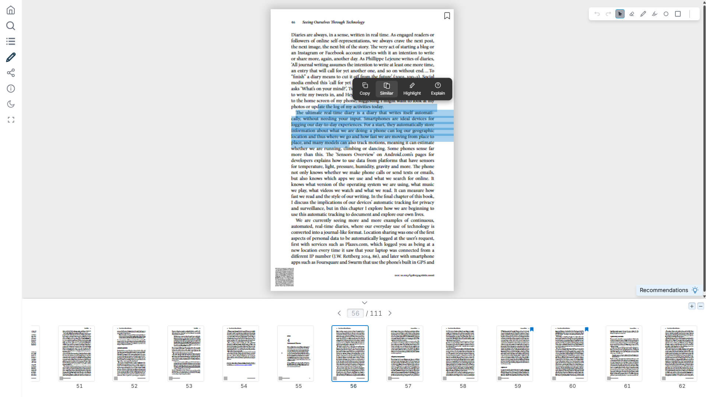

<div align="center">
  <h1>EvilFlowersViewer</h1>
  <p><strong>A focused, extensible PDF workspace for the browser</strong></p>
  <p>
    Read, search, annotate, cite and share documents without leaving the page.
  </p>
  <p>
    <a href="https://github.com/EvilFlowersCatalog/EvilFlowersViewer/releases">
      
    </a>
    <a href="https://www.npmjs.com/package/@evilflowers/evilflowersviewer">
      
    </a>
    <a href="https://github.com/EvilFlowersCatalog/EvilFlowersViewer/blob/main/LICENSE">
      
    </a>
  </p>
  <a href=".github/assets/viewer-preview.jpg">
    
  </a>
</div>

EvilFlowersViewer is a PDF viewer based on the pdf.js library that lets users view and interact with PDF documents
directly in the browser. Developed by a university team, it is reliable, efficient and easy to customize.

## Features

- PDF document rendering directly in the browser
- Zoom in and out of documents
- Page navigation through a page thumbnail view
- Text search within documents
- Optional semantic / AI search shown alongside keyword results
- Share the entire document or with selected pages
- Citation export in BibTeX, BibLaTeX, RIS and bibliography
- Print the entire document or with selected pages
- Download document
- Light / dark themes (honours the host-provided theme, defaults to light)
- Fullscreen mode
- Editing document (freehand, shapes, highlighter, eraser, undo/redo) from a drawing rail docked
  beside the page, so it never covers the document
- Page bookmarks, shown on the page corner and on the thumbnails
- Keyboard-friendly and screen-reader accessible (see [Accessibility](#accessibility))

### Intelligent viewer

Each of these appears only when the host passes the callback it needs (see
[Intelligent viewer](#intelligent-viewer)):

- **Explain** a selected passage, a figure, a table or an equation in a draggable popup, and hand
  the explanation over to the chat
- **Reading chat** about the open publication, docked beside the page: streamed answers with
  links back into the book, recommended publications as cards, and attachments (selected
  text, explanations, figures, highlights) as removable chips
- **Chat history**: reopen earlier conversations; chats about other publications are read-only
- **Figure, table and equation hover**: outlines what the catalog extracted from the page,
  with a card showing the crop, caption, table or LaTeX and actions for the chat and explain
- **AI highlights**: sentences the assistant marked for a prompt, drawn over the text, with a
  comment badge per highlight, a sidebar list to step through them, and show/hide per
  annotation
- **Recommendations**: similar, prerequisite and advanced publications for the open page or a
  selection

## Styling & isolation

All viewer styles are scoped under a single `.efv-viewer` root class and Tailwind's
global preflight is disabled, so **importing this library never restyles the host
application** (`*`, `body`, buttons, inputs and scrollbars are left untouched). It works the
other way too: every utility is emitted as `.efv-viewer .x` (Tailwind `important:
'.efv-viewer'`), so a host that ships its own `.text-primary` or `.bg-secondary` cannot
recolour the viewer. The Inter font is self-hosted (no external Google Fonts request).
Consumers just import the stylesheet — no manual scoping/wrapping required:

```ts
import '@evilflowers/evilflowersviewer/dist/style.css';
```

## Accessibility

The viewer is built to be usable with a keyboard and assistive technologies:

- **Keyboard**: all controls are reachable via <kbd>Tab</kbd>; page thumbnails, tools
  and color swatches respond to <kbd>Enter</kbd>/<kbd>Space</kbd>. Shortcuts:
  <kbd>←</kbd>/<kbd>→</kbd> page, <kbd>+</kbd>/<kbd>-</kbd> zoom, <kbd>F</kbd> search,
  <kbd>T</kbd> table of contents, <kbd>I</kbd> info, <kbd>S</kbd> share, <kbd>C</kbd>
  citation, <kbd>Esc</kbd> steps back out (explain popup → modal → panel → tool → zoom → page →
  close). Typing in the chat or the AI highlights box never triggers these shortcuts.
- **Screen readers**: every icon-only button has an accessible name (localized), toggles
  expose `aria-pressed`/`aria-expanded`, the left rail is a `role="toolbar"`, dialogs are
  `role="dialog"` + `aria-modal` with focus trapping, and loaders announce via
  `role="status"`. The rasterized page canvas is `aria-hidden`; the selectable pdf.js text
  layer carries the readable content.
- **Focus & motion**: a visible `:focus-visible` ring is shown for keyboard users, and all
  animations respect `prefers-reduced-motion`.
- The viewer root carries a `lang` attribute matching `options.lang` so pronunciation is
  correct. All a11y CSS is scoped under `.efv-viewer` and never touches the host page.

## Getting started

**Requirements:** Node **≥ 22.13** (required by pdfjs-dist 6).

To get started with EvilFlowersViewer, follow these steps:

1. Install EvilFLowersViewerPackage:

```bash
npm install @evilflowers/evilflowersviewer
```

2. Import the default `renderPDFViewer` function and the stylesheet:

```ts
import renderPDFViewer from '@evilflowers/evilflowersviewer';
import '@evilflowers/evilflowersviewer/dist/style.css';
```

3. Call it with a single options object. It returns the Vue `App` instance so you
   can unmount it on teardown:

```ts
const app = renderPDFViewer({
  rootId: '#my-viewer',      // CSS selector of the mount element
  data: uint8ArrayOfPdf,      // TypedArray of the PDF bytes
  options: { theme: 'light', lang: 'en' /* … */ },
  config: { download: true, share: true, print: true, edit: false },
});

// later, e.g. on route change:
app.unmount();
```

# Viewer Options and Properties Documentation

| Input                         | Description                                                                         |
| -------------------------     | ----------------------------------------------------------------------------------- |
| rootId                        | ID of your component where you use the `renderViewer` function.                     |
| data                          | TypedArray (e.g. `Uint8Array`) with the PDF bytes.                                  |
| options                       | Optional object consisting of theme, language, citationBib, homeFunction, etc.      |
| options.theme                 | 'dark' or 'light'. Determines the viewer's theme.                                   |
| options.lang                  | 'sk' or 'en'. Specifies the language of the viewer.                                 |
| options.citationBib           | String or null. Contains the citation of the document (e.g., `@article{name, ...}`). |
| options.homeFunction          | Function (type: `() => void`) or null. Redirects to the home view.                  |
| options.closeFunction         | Function (type: `() => void`) or null. Closes the viewer.                           |
| options.shareFunction         | Function (type: `(pages: string | null, expaireDate: string) => Promise<string>`) or null. Generates a shareable link for the document. |
| shareFunction.pages           | String with selected pages (e.g., '1,3-6,10') or null (indicating no pages).        |
| shareFunction.expaireDate     | ISO string specifying the lifespan of the shared document.                          |
| shareFunction => return       | Returns a string containing the link to the shared document.                        |
| options.printFunction         | Function (type: `(pages: string | null) => Promise<string>`) or null. Generates a printable version of the selected pages. |
| options.semanticSearchFunction | Function (type: `(query: string) => Promise<ISemanticSearchResult[]>`) or null. Optional semantic/AI search. When supplied, the search panel shows a second column of AI results (`{ page, text, score? }`) next to the keyword matches; when omitted the panel stays keyword-only. |
| options.editPackage           | Optional object for managing edit features, containing the following functions:     |
| editPackage.saveGroupFunc     | Function (type: `(name: string) => Promise<{ response: { id: string } }>`). Saves a new group and returns its ID. |
| editPackage.getGroupsFunc     | Function (type: `() => Promise<{ id: string; name: string }[]>`). Retrieves all available groups. |
| editPackage.saveLayerFunc     | Function (type: `(svg: string, groupId: string, page: number) => Promise<ILayer | null>`). Saves a new layer to a group on a specific page. |
| editPackage.updateLayerFunc | Function (type: `(id: string, svg: string, groupId: string, page: number) => Promise<void>`). Updates an existing layer in a group on a specific page. |
| editPackage.getLayerFunc  | Function (type: `(page: number, groupId: string) => Promise<ILayer | null> | null`). Retrieves a layer from a group on a specific page. |
| options.pageBookmarkPackage | Optional `{ getBookmarksFunc, addBookmarkFunc, removeBookmarkFunc }` persisting page bookmarks. Without it bookmarks still work but last only as long as the viewer. |
| options.openEntryDetailFunction | Function (type: `(entry: ISuggestedEntry) => void`). Opens the host's detail view for a clicked publication card (recommendations, chat). |
| options.bookmarkToggleFunction | Function (type: `(entry: ISuggestedEntry) => Promise<{ isOnShelf, shelfRecordId? }>`). Adds or removes a card's publication from the reader's shelf. |
| options.suggestionsFunction | Function (type: `(kind: SUGGESTION_KIND, context?: { selectedText?, page? }) => Promise<ISuggestedEntry[]>`). Enables recommendations and the selection menu's "Similar". |
| options.explainFunction   | Function (type: `(text: string, context?: IExplainContext) => Promise<IExplainResult>`). Enables "Explain"; `context` carries `page` and, for a figure/table/equation, `regionId`. |
| options.chatPackage       | Optional `IChatPackage`. Enables the reading chat — see [Intelligent viewer](#intelligent-viewer). |
| options.regionPackage     | Optional `IRegionPackage`. Enables figure/table/equation hover.                      |
| options.agentAnnotationPackage | Optional `IAgentAnnotationPackage`. Enables the AI highlight layer and its sidebar. |
| config                    | Optional configuration object controlling viewer features.                          |
| config.download           | Boolean. Enables or disables the download feature.                                  |
| config.share              | Boolean. Enables or disables the share feature.                                     |
| config.print              | Boolean. Enables or disables the print feature.                                     |
| config.edit               | Boolean. Enables or disables the edit feature.                                      |

## Intelligent viewer

The viewer never talks to a backend itself. Every intelligent feature is a host callback, and
**a feature is hidden entirely when its callback is not passed** — no button, no menu entry, no
layer. All types are exported from the package.

### Coordinates and pages

- Page numbers are always the **reader's** page numbers (1-based, as shown in the viewer). A
  host serving a cut or re-ordered copy converts them before answering.
- Positions (`IPageBox`) are fractions `0..1` of the page width and height with a **top-left
  origin**: `{ x0, y0, x1, y1 }`. They stay correct at any zoom.

### Chat — `options.chatPackage`

```ts
chatPackage: {
  // Required. Stream the answer through the handlers; resolve when done.
  // chatId is the conversation to continue, or null to start one — return the id used.
  sendMessageFunc: async (message, contexts, { onChunk, onMessage, onEntries, onError }, { page, chatId }) => {
    // ...
    return { chatId };
  },
  resetFunc: () => {},                 // optional: forget the current conversation
  suggestions: ['Summarize this chapter'], // optional: prompt shortcuts in an empty chat
  getChatsFunc: async () => [...],     // optional, with getChatFunc: enables chat history
  getChatFunc: async (chatId) => [...],
  deleteChatFunc: async (chatId) => {}, // optional: delete buttons in history
}
```

- The open publication is always the chat's subject and is not sent as a context. `contexts`
  carries what the reader attached: `selection`, `explain`, `region` or `highlight`
  (`IChatContext`).
- Answer text is markdown. `[[page:12]]` and `[[region:<id>]]` render as links that jump into the
  book. `onEntries` shows publications as cards (the assistant's recommendation tool).
- History lists `IChatSummary` items; `aboutThisBook: false` chats open read-only.

### Regions — `options.regionPackage`

```ts
regionPackage: {
  // Called once per page and cached.
  getRegionsFunc: async (page) => [
    { id, kind: 'figure' | 'table' | 'equation', page, bbox, caption, category, markdown, latex, imageUrl },
  ],
}
```

Without `imageUrl` the card crops the region from the rendered page.

### AI highlights — `options.agentAnnotationPackage`

```ts
agentAnnotationPackage: {
  getAnnotationsFunc: async () => [
    { id, title, prompt, summary, status: 'pending' | 'done' | 'failed', unresolvedCount,
      highlights: [{ id, seq, page, quads: [IPageBox, ...], text, note }] },
  ],
  requestAnnotationFunc: async (prompt) => annotation, // optional: "ask to highlight" box
  deleteHighlightFunc: async (annotationId, highlightId) => {}, // optional
  deleteAnnotationFunc: async (annotationId) => {},             // optional
}
```

Each highlight is one sentence in reading order (`seq`), with one quad per text line.

### Trying it locally

`npm run dev` mounts the sample app (`src/App.vue`) with every feature wired to mocks in
`src/assets/examples/params/examples.ts`. The AI highlight mock reads the sample PDF's real text
lines, so highlights land on actual text; region boxes are fixed per page.


## Contributing

We welcome contributions from the community to help make EvilFlowersViewer even better. To contribute, please follow
these steps:

1. Fork the EvilFlowersViewer repository
2. Create a new branch for your changes
3. Make your changes and commit them with a clear commit message
4. Push your changes to your forked repository
5. Create a pull request to merge your changes into the main EvilFlowersViewer repository

## Acknowledgment

This open-source project is maintained by students and PhD candidates of the
[Faculty of Informatics and Information Technologies](https://www.fiit.stuba.sk/) at the Slovak University of
Technology. The software is utilized by the university, aligning with its educational and research activities. We
appreciate the faculty's support of our work and their contribution to the open-source community.


