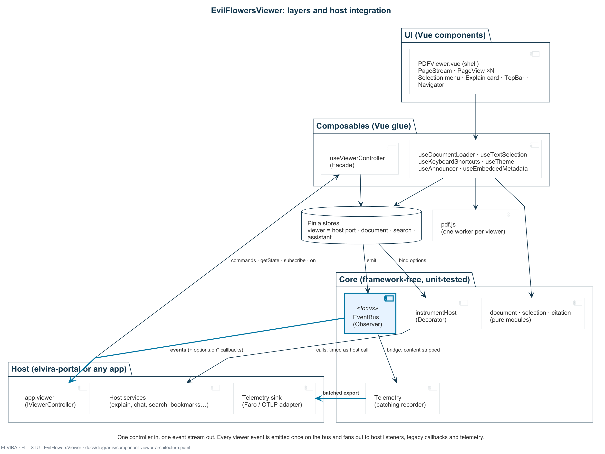

# Architecture

Source: [diagrams/component-viewer-architecture.puml](diagrams/component-viewer-architecture.puml). The reader
shell's UI composition is in [component-reader-shell.puml](diagrams/component-reader-shell.puml), page
ownership in [state-active-page.puml](diagrams/state-active-page.puml), streaming in
[sequence-viewer-streaming.puml](diagrams/sequence-viewer-streaming.puml).

## Layers

Dependencies point down only.

| Layer | Where | Knows about |
| --- | --- | --- |
| **Entry** | `src/main.ts` | Creates one isolated app per mount (Pinia, i18n), exports types only. |
| **UI** | `src/components/**` | Vue components. Render state, forward intent. No host calls of their own except through stores. |
| **Composables** | `src/composables/*` | Vue glue: lifecycle, reactivity, provide/inject. Drive the core and the stores. |
| **Stores** | `src/stores/*` | Per-viewer state (Pinia). `viewer` is the *host port*: host services, config, the event bus and telemetry. |
| **Core** | `src/core/**` | Framework-free TypeScript: no Vue, no stores. Unit-tested (`*.test.ts`). |
| **Contracts** | `src/assets/utils/interfaces.ts`, `src/core/telemetry/types.ts` | The public types; the only declarations shipped. |

### Core modules

| Module | Responsibility |
| --- | --- |
| `core/events/EventBus` | Typed publish/subscribe with isolated listeners. |
| `core/telemetry/Telemetry` | Batching recorder: queue, flush on size/interval/page exit, no-op without a sink. |
| `core/telemetry/instrumentHost` | Wraps host functions to time them (`host.call`, `chat.first_token`). |
| `core/telemetry/bridge` | Viewer events → telemetry, stripping content. |
| `core/telemetry/longFrames` | Long Animation Frames / Long Tasks observer. |
| `core/document/documentSource` | Source → pdf.js parameters; the per-viewer worker; lazy worker chunks. |
| `core/document/loadErrors` | Classifies load and page failures (auth, not found, network, invalid, password). |
| `core/document/outline` | Outline with resolved pages; named destinations. |
| `core/document/pageRange` | Share/Print page selections. |
| `core/selection/textSelection` | pdf.js' selection guard and the selection model (page-fraction line boxes). |
| `core/citation/bibtex` · `embeddedMetadata` | BibTeX reader; Highwire tags and COinS for reference managers. |
| `core/citation/formatter` | citation-js, loaded lazily by the Cite card. |
| `core/storage/preferences` | The reader's stored preferences (theme, citation style). |
| `assets/utils/rangeTransport` | Range loading with refreshable headers. |

### Composables

| Composable | Responsibility |
| --- | --- |
| `useDocumentLoader` | One load at a time; old document stays until the new one parsed; outline, labels, retry, disposal. |
| `useViewerController` | The host's controller (Facade): commands, frozen state snapshot, `subscribe`, `on`, AI context. |
| `useTextSelection` | One selection controller per viewer, shared by the pages. |
| `useExplanation` | Everything an Explain card shows, each part loading on its own, all aborted together. |
| `useKeyboardShortcuts` | Key → action map, scoped to the viewer last used. |
| `useTheme` | Host theme → stored choice → system preference. |
| `useAnnouncer` | Polite live region for screen readers. |
| `useEmbeddedMetadata` | Reference-manager metadata in the document head. |

## Patterns

- **Facade**: `IViewerController` is the only way in. Hosts never see stores or components.
- **Observer**: every fact the viewer reports is emitted once on the `EventBus`; host listeners, `options.on*`
  callbacks (bound as listeners in `viewerStore.bindOptions`) and telemetry (the bridge) all subscribe to it.
- **Adapter**: `bridgeTelemetry` adapts events to telemetry; hosts adapt the telemetry sink to Faro or OTel.
- **Decorator**: `instrumentHost` wraps host services with timing without call sites knowing.
- **Command**: keyboard shortcuts are a key → action map, one place for every binding.
- **Ports and adapters**: `viewerStore` is the port the UI uses to reach host services; hosts plug adapters
  (their API clients) into it through options.
- **External store snapshot**: `getState()` is a cached, frozen computed value; `subscribe()` notifies on
  change, which is exactly React's `useSyncExternalStore` contract.

## Data flow examples

**Page change.** Scrolling sets `docStore.activePage` (`setActiveFromScroll`, cause `scroll`). The shell's watcher
emits `page-change` once. Host listeners, `onPageChange` and the telemetry bridge (`navigation`, `page.view`)
receive it, the announcer speaks the page after the scroll settles, and `getState()` produces a new snapshot,
so `subscribe` listeners run.

**Explain.** A pointer-up on a text layer → `TextSelectionController` reads the selection into line boxes →
`selection-change` → the page that owns the selection shows `SelectionMenu` → *Explain* stores an
`IExplainRequest` (with the boxes, so the passage stays marked) → `useExplanation` calls `explainFunction`
(wrapped by `instrumentHost`) with an `AbortSignal` and `onPartial`, then related passages and other
publications → `ExplainPopup` renders the parts as they arrive, inside a `FloatingCard` anchored to the
passage.

## Where to change what

| To… | Change |
| --- | --- |
| add a host option | `IViewerOptions` (interfaces.ts), `viewerStore` (`SERVICES` or `bindOptions`), docs/host-integration.md |
| add an event | `IViewerEventMap`, emit it where the fact happens, `CALLBACK_EVENTS` if it has an `on*` option, the bridge if telemetry wants it, both docs |
| add a telemetry event | `TELEMETRY_EVENT` (closed set), record it, docs/telemetry.md (no content, bounded attributes) |
| add a shortcut | the map in `PDFViewer.vue` (`shortcuts`), the tooltip of its button, README keyboard section |
| add a lazy feature | `import()` it where it is first needed, or `defineAsyncComponent`; check `dist/chunks` after a build |
| add a translation | `src/assets/lang/en.json` and `sk.json` (same key in both) |

## Decisions

- **Scoped CSS, not Shadow DOM.** pdf.js text layers, printing and fullscreen work against the document; a
  scoped root class (`.efv-viewer`, Tailwind `important`) isolates styles both ways at no cost.
- **Legacy pdf.js build.** It carries the polyfills older browsers need; the modern build would raise the
  browser floor for every host.
- **Tailwind 3.** Tailwind 4 requires Chrome 111 / Safari 16.4 for every consumer.
- **TypeScript 6.** Tried 7.0.2 on 2026-11-18: vue-tsc 3.3.14 fails to start (`typescript/lib/tsc` is no
  longer exported) and Volar declares `typescript <7`. Re-check when vue-tsc supports 7.
- **citation-js 0.7, scoped plugins.** 0.9's core depends on Node-only `sync-fetch-undici`.
- **Fonts inlined in `style.css`.** Library mode inlines CSS assets; one self-contained stylesheet lets hosts
  inject it as a string. One variable woff2 per subset keeps it at ~180 kB of the 244 kB.
